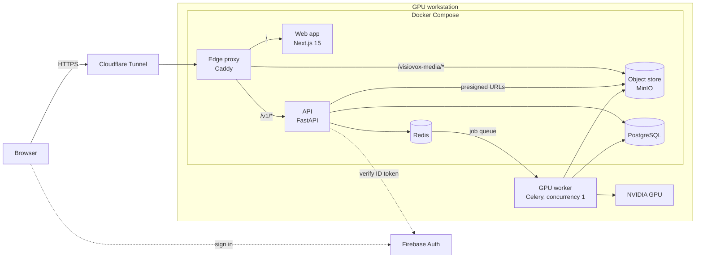
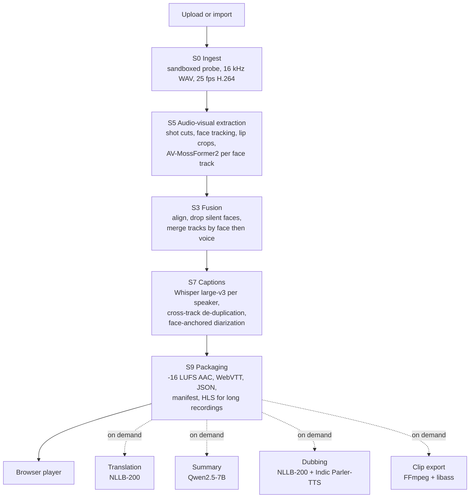
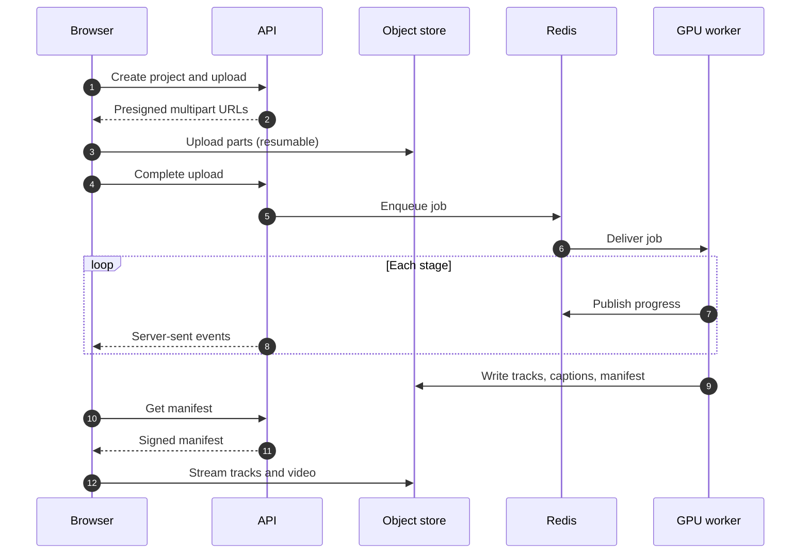

<div align="center">

# VisioVox

**Upload a video where people talk over each other. Pick a speaker. Hear only them.**

VisioVox turns a multi-speaker video into one isolated audio track per visible speaker,
locked to the video, switchable during playback, with word-aligned captions for each person.


[Features](#features) · [Architecture](#architecture) · [Getting started](#getting-started) ·
[Results](#results) · [Documentation](#documentation)

</div>

---

## Overview

When several people speak at once into a single microphone, the recording is hard to follow and
transcripts attribute words to the wrong person. Meeting tools give labelled *text* but leave the
audio mixed; music stem separators do not split speakers; research separation models produce
waveforms, not a product.

VisioVox uses **audio-visual target speaker extraction**: each output track is conditioned on one
person's lip movements, so every track belongs to a face by construction. On top of the separated
tracks it builds per-speaker captions, conversation analytics, translation, summaries and dubbing,
all delivered in a browser player that switches between speakers without a gap.

Everything runs on a single GPU workstation. No third-party AI APIs are called: every model runs
locally.

## Features

| | Feature | Description |
|---|---|---|
| 🎧 | **Per-speaker isolation** | One full-length track per visible speaker (up to 8), plus the original mix |
| 🔀 | **Instant switching** | All tracks in one Web Audio context; 80 ms equal-power crossfade, drift-corrected to the video |
| 🖱️ | **Click a face** | Click a person in the video to hear only them |
| 🎚️ | **Voice mixer** | Turn each speaker up or down independently and export your own mix |
| 📝 | **Per-speaker captions** | Word-aligned captions for every track, with cross-track de-duplication |
| 🔎 | **Interactive transcript** | Searchable who-said-what transcript; rename speakers; export DOCX, SRT, VTT or TXT |
| 📊 | **Conversation insights** | Talk time, turns, pace, overlap and interruptions on a timeline |
| 🌐 | **Translated captions** | 40 languages, 18 of them Indian, shown with the original words beneath |
| 🧾 | **Summary and action items** | Generated locally; every item cites the transcript lines it came from |
| 🗣️ | **Per-speaker dubbing** | Dub each person into 15 languages (14 Indian and English) while the rest of the room is kept |
| ✂️ | **Clip export** | Export a time range with your mix and optional burned-in captions |
| 📥 | **Flexible import** | Resumable direct upload, a YouTube or Vimeo link, or Google Drive and Photos, with trimming |
| 🔗 | **Share links** | Share a read-only player for a project |
| ⏱️ | **Live progress** | Stage-by-stage progress over server-sent events, with a time estimate learned from past jobs |

## Architecture

### Deployment

A browser reaches exactly one origin. The edge proxy routes API calls, media and the web app; the
GPU worker runs on the host and consumes jobs from Redis.



Uploads and playback go directly between the browser and the object store on presigned URLs, so
large files never pass through the API. The API never imports worker code; it enqueues jobs by task
name, and a single-concurrency worker processes them in order.

### Processing pipeline



### Request flow



### Models

| Task | Model |
|---|---|
| Speaker extraction | AV-MossFormer2 (ClearerVoice-Studio), S³FD face detector |
| Track merging | ArcFace face embeddings (InsightFace), ECAPA voice embeddings (SpeechBrain) |
| Captions | Whisper large-v3 via faster-whisper, Silero VAD |
| Diarization for insights | pyannote 3.1 |
| Translation | NLLB-200 distilled 1.3B via CTranslate2 |
| Summary and action items | Qwen2.5-7B-Instruct via Ollama |
| Dubbing voices | Indic Parler-TTS |

The repository also contains **SEAVE**, our own 5.0 M-parameter TF-GridNet-style extractor with
reliability-gated audio-visual conditioning, with its training and evaluation code (`ml/`). The
paper reports both; the deployed system serves AV-MossFormer2.

## Tech stack

| Layer | Technologies |
|---|---|
| Machine learning | PyTorch, faster-whisper, pyannote, SpeechBrain, InsightFace, CTranslate2, Ollama |
| Backend | FastAPI, SQLAlchemy, Alembic, Celery, PostgreSQL 16, Redis 7 |
| Media | FFmpeg (sandboxed), MinIO (S3-compatible), HLS, WebVTT |
| Frontend | Next.js 15, React 19, TypeScript, Tailwind CSS 4, Web Audio API, hls.js, Zustand |
| Identity | Firebase Authentication (email/password and Google) |
| Infrastructure | Docker Compose, Caddy, Cloudflare Tunnel, systemd |
| Tooling | uv, pnpm, Ruff, mypy (strict), ESLint, Prettier, pytest, Vitest, Playwright, GitHub Actions |

## Repository structure

```
apps/
  api/            FastAPI control plane: projects, uploads, jobs, media, exports, sharing
  web/            Next.js app: landing page, upload, projects, player
services/
  worker-gpu/     Real pipeline worker, AV-TSE runner, TTS runner
  worker-cpu/     Mock pipeline worker (fixture results, no GPU)
ml/
  pipeline/       Pipeline stages (ingest, extraction, fusion, captions, translation, dubbing, ...)
  models/         SEAVE extractor
  training/       Data simulation, losses, trainer
  eval/           Metrics and evaluation harness
packages/
  contracts/      OpenAPI spec and playback manifest schema
  ts-client/      Generated TypeScript API client
  py-client/      Python API client
infra/
  docker/         Compose files, Dockerfiles, Caddyfile, media sandbox image
  local/          Deploy, preview and backup scripts, GPU worker systemd unit
scripts/          Benchmarks, dataset preparation, training and evaluation entry points
tests/            Python test suite
e2e/              Playwright end-to-end tests
docs/             Design documents and architecture decision records
paper/            IEEE paper sources
```

## Getting started

### Prerequisites

| Requirement | Version | Notes |
|---|---|---|
| Linux or WSL2 | Ubuntu 22.04+ | On WSL2, clone into the Linux filesystem, not `/mnt/c` |
| Python | 3.12 | Managed by [uv](https://docs.astral.sh/uv/) |
| Node.js | 22+ | With pnpm 9 (`corepack enable`) |
| Docker | with Compose v2 | Runs PostgreSQL, Redis, MinIO and MailHog |
| FFmpeg | 6+ | `sudo apt install ffmpeg libsndfile1` |
| Firebase project | free tier | Email/password sign-in enabled |
| NVIDIA GPU | 24 GB VRAM recommended | Only for the real pipeline; the mock pipeline needs none |

### 1. Clone and install

```bash
git clone https://github.com/shreyassridhar44/VisioVox-New.git visiovox
cd visiovox
uv sync --all-packages                      # add --extra ml for training and the real pipeline
pnpm install
pnpm --filter @visiovox/ts-client build     # the web app imports the built API client
```

### 2. Configure

```bash
cp .env.example .env
```

In the [Firebase console](https://console.firebase.google.com/), create a project, enable the
**Email/Password** provider (and **Google** if wanted), then fill in `.env`:

| Variable | Where to find it |
|---|---|
| `NEXT_PUBLIC_FIREBASE_API_KEY`, `NEXT_PUBLIC_FIREBASE_AUTH_DOMAIN`, `NEXT_PUBLIC_FIREBASE_PROJECT_ID`, `NEXT_PUBLIC_FIREBASE_APP_ID` | Project settings → General → Your apps → Web app config |
| `FIREBASE_PROJECT_ID` | The same project ID |
| `FIREBASE_CREDENTIALS_FILE` | Project settings → Service accounts → Generate new private key. Save it as `secrets/firebase-service-account.json` (gitignored) |

Create the media directory the API uses for uploads and scratch space:

```bash
sudo mkdir -p /srv/media && sudo chown "$USER" /srv/media
```

### 3. Run locally (mock pipeline, no GPU)

The mock pipeline returns fixture results, so the whole application (upload, processing view,
player, speaker switching, captions) runs on any machine.

```bash
make dev                                   # PostgreSQL, Redis, MinIO, MailHog
uv run alembic upgrade head                # database schema

# each in its own terminal
uv run uvicorn visiovox_api.main:app --reload --port 8000
uv run celery -A worker_cpu.tasks:celery_app worker --loglevel=info --concurrency=1
pnpm --filter @visiovox/web dev
```

Open <http://localhost:3000> and sign up with any email address.

### 4. Run the real pipeline (GPU)

1. Install the ML extras: `uv sync --all-packages --extra ml`.
2. Set up the extractor in its own environment: clone
   [ClearerVoice-Studio](https://github.com/modelscope/ClearerVoice-Studio), create a virtual
   environment for it, download the `AV_MossFormer2_TSE_16K` checkpoint into
   `clearvoice/checkpoints/`, and point `AV_TSE_PYTHON` and `AV_TSE_CLEARVOICE_DIR` at them.
3. Accept the terms of the gated [pyannote](https://huggingface.co/pyannote/speaker-diarization-3.1)
   and [Indic Parler-TTS](https://huggingface.co/ai4bharat/indic-parler-tts) models and set `HF_TOKEN`.
4. For translation, summaries and dubbing: convert NLLB-200 for CTranslate2
   (`TRANSLATION_MODEL_DIR`), create the TTS environment (`TTS_PYTHON`), and install
   [Ollama](https://ollama.com/) with `qwen2.5:7b-instruct`.
5. Build the sandbox image used to probe uploads:
   `docker build -f infra/docker/media-sandbox.Dockerfile -t visiovox/media-sandbox:1 .`
6. Set `PIPELINE_MODE=real` in `.env` and start the GPU worker instead of the mock worker:

```bash
uv run celery -A worker_gpu.tasks:celery_app worker --loglevel=info --concurrency=1 --queues=gpu
```

### 5. Production deployment

The production stack runs on the GPU workstation and is published through a Cloudflare Tunnel, so
it needs no public IP or open inbound port.

```bash
cp .env.production.example .env.production       # domain, secrets and Firebase config
echo "<tunnel-token>" > secrets/cloudflare-tunnel-token.txt

sudo cp infra/local/visiovox-worker-gpu.service /etc/systemd/system/
sudo systemctl daemon-reload && sudo systemctl enable --now visiovox-worker-gpu

./infra/local/deploy.sh --local       # production images on http://127.0.0.1:8080
./infra/local/deploy.sh --tunnel      # production images behind the tunnel
./infra/local/deploy.sh --rollback    # previous images, same data
```

`deploy.sh` checks secrets and the media volume, builds the images, runs migrations, waits for the
GPU worker to be idle and starts the stack. The full procedure, including domain and tunnel setup,
is in the [operations runbook](./docs/23-runbook.md).

## Development

```bash
make help              # list every target
make test              # Python test suite (GPU tests skipped)
make test-gpu          # GPU-marked tests
make lint              # Ruff and ESLint
make typecheck         # mypy --strict and tsc
make fmt               # Ruff format and Prettier
make contracts         # regenerate the OpenAPI spec and TypeScript client
make check             # everything CI runs
pnpm test              # TypeScript unit tests (Vitest)
pnpm test:e2e          # end-to-end tests (Playwright)
```

Commits follow [Conventional Commits](https://www.conventionalcommits.org/)
(`type(scope): subject`); see [CONTRIBUTING.md](./CONTRIBUTING.md).

## Results

Measured on **AMI-AV**, a real-recording benchmark we built by tiling the AMI Meeting Corpus
close-up cameras over the summed headset audio (30 meetings, 10 held out).

| Measure | Result |
|---|---|
| Separation gain on overlapped speech, face visible | +3.48 dB SI-SDR |
| Word attribution error, held-out meetings | 110% → 78% with cross-track de-duplication |
| Overlap detection F1 | 0.38 → 0.77 with face-anchored diarization |
| Interruption detection F1 | 0.07 → 0.21 |
| Action items | recall 0.40, correct owner 58% |
| Original voice under a dub | −16.5 dB |
| Hindi dub, speech-recognition round trip | median character error 0.047 |
| Processing time, one RTX A5000 | median 2.6× the recording length |
| Processing time without a GPU | 5.4× slower |

Methods, caveats and the SEAVE training results are in the [paper](./paper/) and
[`docs/29-ami-av-evaluation.md`](./docs/29-ami-av-evaluation.md).

## Limitations

- **Faces must be on screen.** The extractor follows lip movement; speech from someone off-camera or
  turned away is not recovered (14.4% of AMI speech is spoken while the speaker's face is untracked).
- **Offline only.** Recordings are processed after upload, up to 60 minutes and 8 speakers.
- **Speech, not music.** Singing and music are out of scope.
- **Generic dub voices.** Dubbing uses a synthetic voice per speaker; it does not clone voices.
  Translation quality and dub naturalness have not been rated by listeners.
- **Decisions are not extracted.** Summaries find action items but missed every decision in the
  AMI evaluation.

## Privacy

- Face crops and voice embeddings exist only while a job runs and are never stored as templates.
  Each speaker card keeps one still from the video, deleted with the project.
- There is no identification of people and no matching across videos, by design
  ([ADR-0008](./docs/adr/0008-ephemeral-biometrics.md)).
- All models run on our own hardware; recordings are not sent to any third-party AI service.
- Uploaders confirm they have the right to upload each recording, and deleting a project removes
  its media and results.

## Documentation

| Document | Contents |
|---|---|
| [System design](./docs/09-system-design.md) | Services, data flow and failure handling |
| [ML architecture](./docs/05-ml-architecture.md) | SEAVE and the pipeline stages |
| [Media pipeline and sync](./docs/12-media-pipeline-and-sync.md) | How switching stays gapless and in sync |
| [API specification](./docs/11-api-spec.md) | Endpoints and contracts |
| [Operations runbook](./docs/23-runbook.md) | Setup, deployment and operations |
| [AMI-AV evaluation](./docs/29-ami-av-evaluation.md) | Benchmark construction and results |
| [Decision records](./docs/adr/) | Architecture decision records |
| [All documents](./docs/README.md) | Full index |

## Acknowledgements

VisioVox builds on [ClearerVoice-Studio](https://github.com/modelscope/ClearerVoice-Studio)
(AV-MossFormer2), [Whisper](https://github.com/openai/whisper) and
[faster-whisper](https://github.com/SYSTRAN/faster-whisper),
[pyannote.audio](https://github.com/pyannote/pyannote-audio),
[SpeechBrain](https://speechbrain.github.io/), [InsightFace](https://github.com/deepinsight/insightface),
[NLLB-200](https://ai.meta.com/research/no-language-left-behind/), [Qwen2.5](https://github.com/QwenLM/Qwen2.5),
[Indic Parler-TTS](https://huggingface.co/ai4bharat/indic-parler-tts) and the
[AMI Meeting Corpus](https://groups.inf.ed.ac.uk/ami/corpus/).

## Licence

No licence has been granted for this repository yet. Third-party models keep their own licences;
NLLB-200 in particular is licensed for non-commercial use only (CC BY-NC 4.0).
